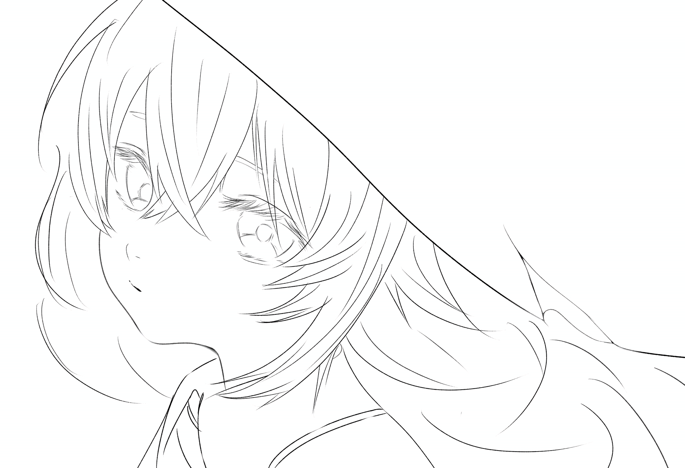
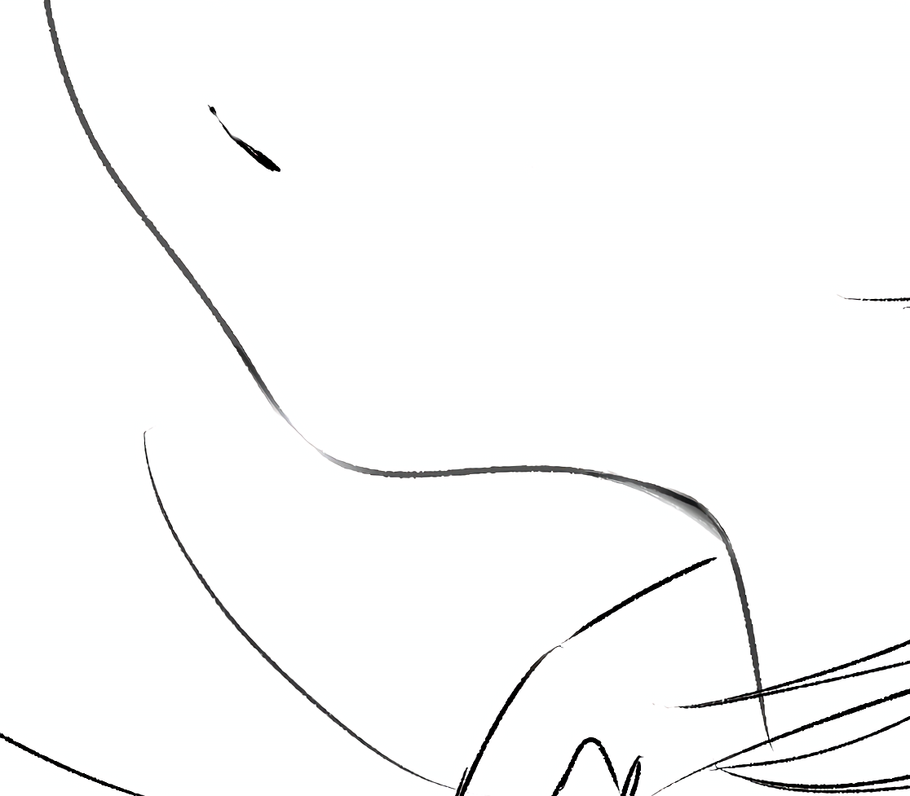
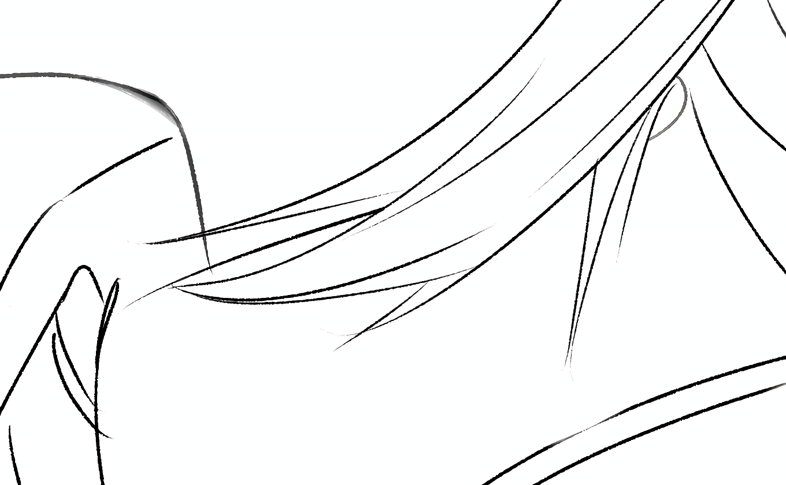
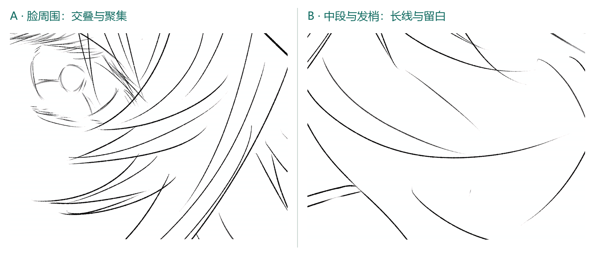
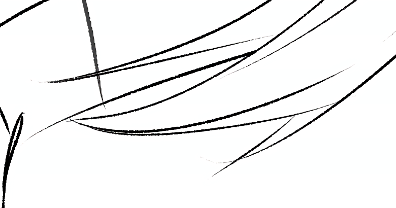
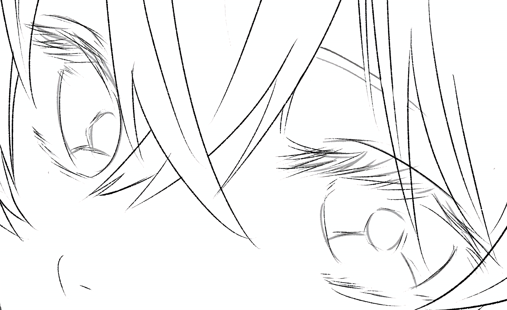
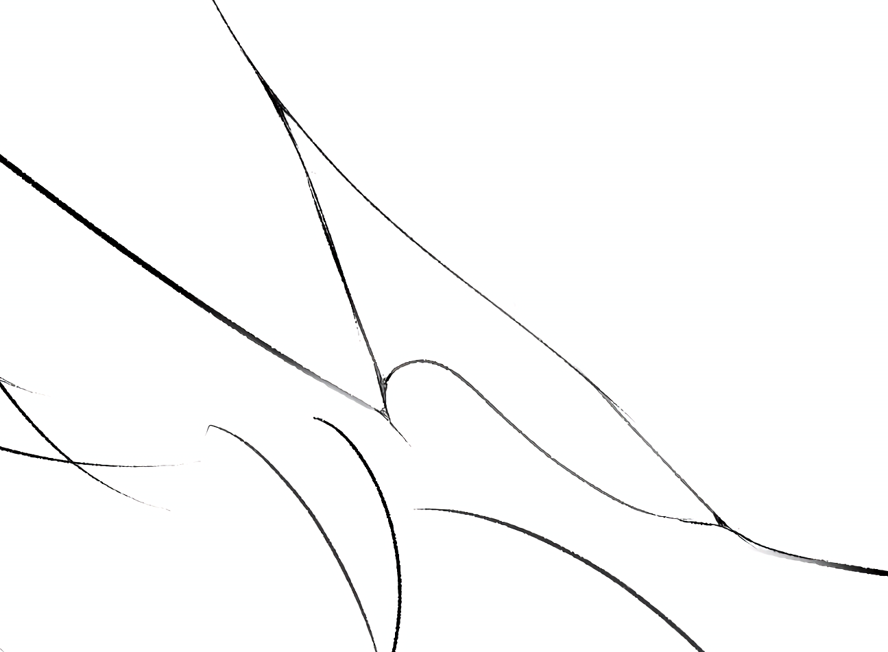

这张图里，我最满意的是下巴那段曲线，很可爱。它从脸颊往下收，再轻轻转过去，给整个脸型带来了一点柔软的感觉。

但画完再看，问题也挺集中：想让线条有变化，却一直没有设置笔压；想让下巴通透一点，擦出来的淡线又有些孤立；想让头发留一点想象空间，却不太确定哪里是省略，哪里只是没交代清楚。眼睛远看细密，放大后满是保留下来的草稿；帽沿的小裂口，也比我想要的圆了一些。

这篇就拿自己的这张图做一次复盘。配图中的局部都来自原稿，只做裁切和缩放，没有重描或调整对比度。对现有画面的观察和下一次想尝试的修改，会分开来说。

[查看原尺寸线稿](../images/drawing/line-art-study/original.png)

## 没有设置笔压，就用橡皮一点点修

我以前在 SAI2 上绘画，没有给线条设置笔压。现在转到平板，这个习惯也没改。在需要线条自然变粗、变细的地方，确实挺吃亏的。

我的办法是拿低透明度橡皮，一点一点擦出变化。说起来有点像“原始人做法”：别人可能通过落笔和提笔一次完成的变化，我得在画完以后慢慢修。

不过，手工擦线并不是无效的方法。它给了我重新分配线条轻重的机会，只是需要多花一道工序。这里值得分清三种效果：

- **变细**：从线的侧面削掉一部分，改变它的宽度。
- **变淡**：降低一段线的可见程度，宽度未必明显改变。
- **断开**：让某一小段轮廓消失，由前后的走势提示它原本的位置。

这三种都能让线条看起来轻一些，但作用不同。在线的中间反复擦，往往先得到一条淡线；想获得收尖的线尾，则要顺着线的方向，从两侧逐步收进去。把“浅”当成“细”来处理，容易让该明确的轮廓变得犹豫。

如果继续沿用现在的画法，我会先在副本上给线条分工：决定形状的主轮廓保持清楚，转折和交叠处适当强调，内部纹理与部分线尾再放轻。每修一小段，就缩回正常观看尺寸检查，不一直盯着放大的像素修。

下一次也值得先做一个很小的笔压试验：只让压力影响笔刷大小，暂时不同时改变不透明度，画几组同样的长弧线和收尖线，比较哪一种更容易控制。笔压能减少手工修线的负担，但哪里该重、哪里该轻，仍然要自己决定。

## 下巴：我喜欢这条曲线，也想保留它的轻

下巴附近，我特意擦淡了一段，想给画面增加一点通透感。它也是这张图里我最舍不得改坏的地方。

从局部看，前后的曲线仍然能接起来。即使中间有一段比较淡，眼睛也能顺着方向把形状补全，所以它没有完全变成一道缺口。那段缓缓转过去的轮廓，加上脸部比较大的留白，让下巴显得柔和。

我觉得有点奇怪的，是这处虚化特别容易被注意到。如果全图多数主要轮廓都比较完整，只有这里明显变淡，它就可能从一种轻重变化，变成一个需要解释的特殊位置。

而且，这还是一张没有明确铺开明暗关系的线稿。单靠这段淡线，不能硬说它就是某个确定光源造成的受光边缘。这里更适合先按轮廓的虚实节奏来判断。

如果再修，我会先试着收敛这一次擦除：让实线到淡线的过渡稍微长一点，避免变化过于集中；同时保留下巴转弯前后的关键轮廓，让可爱的曲线仍然读得出来。

然后再看，画面其他地方是否也有适合放轻的线尾或内部线。只有那些位置本来就可以省略，才值得形成呼应。为了让下巴“不孤单”而到处擦出缺口，反而会破坏形状。

**我想保留的是这条曲线的柔软，而不是让擦除本身成为最显眼的效果。**

## 脖子：一点闭塞，为什么会显得单独

脖子那一处，我稍微加了一点闭塞。但只有这一处比较显眼，也让我觉得整体的氛围还没有营造到位。

这里说的闭塞，可以理解为遮挡或贴近的位置不容易接收到周围的光，因而留下较深的一小块。它不等于把交叉线一律涂黑，也不需要整张图先铺满阴影才能使用。就这张线稿而言，这点灰暗更像一个局部提示，还没有展开成完整的明暗关系。

放回整张图里看，问题和下巴的淡线有点相似：多数区域仍用轮廓和留白交代形状，脖子却多了一点阴影处理，于是容易显得单独。下一次我会先选方向：如果继续保持轻盈的线稿，就收小这点暗部，让它顺着转折自然变窄；如果想加强体积感，再检查头发贴近脖子、发束互相覆盖等位置，选择确实有遮挡依据的地方加少量暗部，并拉开强弱。

形成呼应并不意味着每个交界都要补黑。下巴的淡和脖子的暗，一个在减轻轮廓，一个在增加重量；都需要放回整体里判断力度。先缩小看一眼，再决定保留多少，比为了统一而到处添加阴影更适合这张图。

## 头发：线少以后，方向还要留得住

头发的疏密是我这次有意识在做的部分。靠近头部、脸周围的地方，我加了相对多的线；中段到发梢，则寥寥带过，希望空出来的地方能让人自己补完。

画完后我有点怀疑是不是失败了。但把两个局部放在一起看，疏密差异其实存在：脸旁的发束交叠更集中，下方则主要由几条长弧线带过。

[查看 A 局部原尺寸](../images/drawing/line-art-study/hair-near.webp) · [查看 B 局部原尺寸](../images/drawing/line-art-study/hair-ends.webp)

所以，比起直接给发梢补满线，更值得检查的是：留下的几条线，有没有把发束的方向、分组和结束位置说清楚。

可以把头发里的线粗略分成三种：外轮廓告诉我这团头发占据什么形状，发束交界告诉我它怎么分组、谁压着谁，少量内部线再提示流向。每根线都承担同样的重量、都一路画到底，密处容易像一排平行条纹；少处如果只留下几条游离的弧线，也可能让人不确定它们属于哪一束。

这张图中，脸旁有些发束已经通过交叠形成了方向，这是可以保留的。下一步我更想做的是减少“重复说明同一件事”的线，而不是平均地减少每个区域的线数。

具体到修改，我会先挑出每一组发束最有用的一两条走势，让它们完整地带出形状；旁边的辅助线可以更短、更淡，或者在到达发梢之前结束。发梢也不必每一束都收成同样尖、同样完整的轮廓，但整组头发朝哪里走，仍要看得出来。

所谓想象空间，需要一点可靠的提示。形状已经成立之后留下的空白，读者才更容易接着往下想。

### 发梢分叉：细节存在，还要让它被读到

在头发结束的地方，我也稍微加了一丝分叉。它是一个很小的方向提示：发束到末端并不是整齐地合成一个尖点，而是有两股线在最后分开。

不过，如果不细看，它和普通的不分叉头发几乎差不多。这不一定说明分叉没有用，也可能是它的尺度、位置和周围线条的轻重都太接近，缩小以后就被主轮廓吞掉了。如果想让它在整体上被注意到，就需要在正常观看距离下仍能读出一点轮廓差别。

下一次我会先决定这根分叉承担什么任务：如果只是让发梢不那么整齐，可以保留现在这样轻轻带过；如果希望它成为可见的造型特征，就要让两条末端的间距稍微拉开，或者让其中一条更短、更尖，再把连接处擦得干净一些。分叉不需要画粗，但要和主线有明确的方向差。

这也和前面的疏密问题相连：如果我希望分叉改变整体轮廓，就应该在预期展示尺寸下检查它；如果只想留一点近看才发现的细节，现在这种微弱的程度也可以成立。不必让每一处分叉都抢眼，挑一两处拉开长短和夹角，其他地方继续轻轻带过，或许更符合这张图想保留的松散感。

## 眼睛：保留草稿的活气，也要决定哪条线作数

眼睛部分，我保留了绝大多数草图。当时想要的是一种细密、精致的感觉。远看还可以，细看就完全经不起推敲——这是我画完后的直观感受。

放大以后能看到，眼睑与睫毛附近叠着不少方向相近的细线。这些线集中在很小的范围里，缩小观看时，会合成一片较深的区域，让眼睛显得有内容。它确实参与了画面的细密感。

但草稿中的每条线都留下来，就不容易看出哪一条是最后确定的边界。尤其是围绕眼睑或虹膜反复寻找形状的线，如果彼此距离很近、轻重又差不多，放大后读到的就会是犹豫，而不只是丰富。

我不想把这里全部清得很光滑。那样也许会干净，却可能丢掉现在这种轻微的手绘感。更合适的做法，是先确定少数作数的线：上眼睑的走向、眼角的位置、虹膜的主要边界，然后再决定哪些细碎线值得保留。

睫毛附近可以留一点分叉和不完全均匀的线尾；围着同一个轮廓反复绕行、又没有提供新信息的线，则可以减掉一些。下眼睑也可以比上眼睑更轻，避免上下两圈都同样抢眼。这里说的是可尝试的主次安排，不是所有画风都必须遵守的固定规则。

检查时，我会在两个尺寸之间来回看：放大看形状是否明确，缩小看眼神和整体重量是否还在。原图有 4864 × 3328 像素，并不需要每一个像素都像正式描线一样整齐；但正常观看时，眼睛的方向和表情应该先于杂线被读到。

## 帽沿：想要更硬的裂口，就要调整转折

帽子这里，我用一笔相对厚重的长线带下来，再在偏下的位置留了一个小裂口。大轮廓比较明确，小裂口则是我想给它增加的一点变化。

现在看，这个缺口的弧度有点大。它更容易读成柔软的起伏，而不是一个较硬的边缘转折。

不过，“更硬”不等于把整顶帽子都改成直线。如果我的目标就是让这处裂口更利落，重点应该放在缺口自己的形状：两边分别朝哪个方向走，内角在哪里收住，转折之前要不要留一小段较直的边。

我会先缩小那段圆弧，让它更快地转向；再减少交界处含混的接线，明确哪一条是帽沿的主轮廓。必要时，只用一小段较实的线强调内角，不把整圈缺口都描得一样重。

这处还可以单独截出来，做两个小版本比较：一个保留圆弧，一个把内角收紧。放回全图以后，再看它们与长帽沿是否协调。如果帽子本来要表现软布，圆曲线并不天然错误；只是它与我这次希望得到的偏硬转折不太一致。

## 下一张，先把线条的主次定下来

这次复盘之后，我不想立刻把整张图重新描一遍。下巴那段曲线我还是很喜欢，头发的轻和眼睛保留的草稿感，也都有值得留下的部分。

如果继续练，我会把目标缩到几件具体的事：

1. 先做一页小型笔压对照，只改变粗细，看看能否减少后期擦线的次数。
2. 在原稿副本上只修下巴的渐淡过渡，确认喜欢的脸型没有被破坏。
3. 脖子的闭塞先做减轻与保留两个版本；只有想加强体积感时，再给有遮挡依据的位置补少量呼应。
4. 每组头发先选出关键轮廓，再决定辅助线在哪里结束；挑一两处发梢比较分叉的长短与夹角，缩回正常尺寸检查。
5. 眼睛只清理重复的候选线，保留有方向、有作用的细碎线；帽沿则单独比较圆弧和紧转折。

我想让下一张图里的线条更有选择：有些负责把形状说清楚，有些可以轻轻带过。这样，下巴那一点我很喜欢的柔软，就能更自然地留在整张画里。

---

线稿与绘画心得由本人提供。SAI 产品标识来自 [SYSTEMAX 官方 SAI2 开发页面](https://www.systemax.jp/en/sai/devdept.html)，用于说明过去的绘画工具经历。
