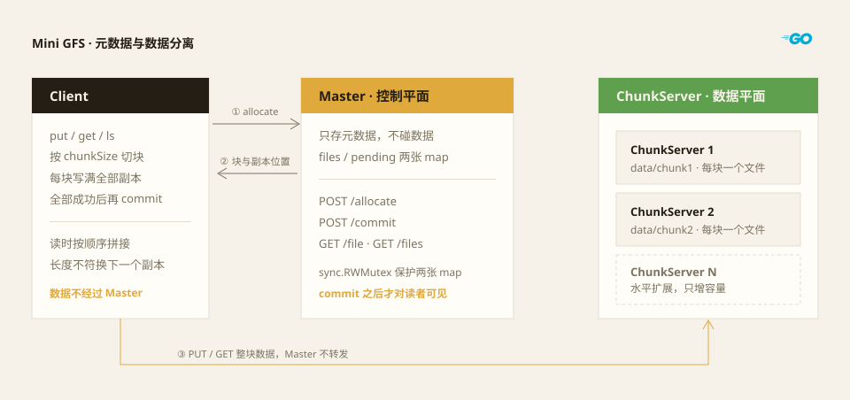

用 Go 标准库实现最简的 GFS 风格存储系统

## **架构**



系统里只有三类角色，其中 ChunkServer 可以部署任意多个：

- **Client**：先向 Master 请求元数据，拿到 chunk 位置后，直接和 ChunkServer 读写数据。
- **Master**：控制平面，只保存文件名、大小、chunk ID 和副本位置。
- **ChunkServer**：数据平面，真正存放 chunk 数据，每个节点只负责一部分 chunk。

关键在于数据不经过 Master：控制流和数据流分开，Master 才不会成为带宽瓶颈。同一个 chunk 会按副本数写到不同的 ChunkServer 上，位置按 `(i+j) % len(servers)` 轮转取，相邻 chunk 的副本不会挤在同一台机器上。

## 环境

- **编译器**：Go 1.22
- **操作系统**：Windows 11

*本次用多进程模拟多主机环境，通信协议使用 HTTP*

-------

接下里讲解本系统有关分布式的几个重要取舍：
- 可用性（容错）
- 可扩展性（可以通过增加节点来提升性能或存储容量）
- 一致性（数据的一致性）

### 可用性

ChunkServer 采用多节点部署，每个节点负责存储部分 chunk，同一个 chunk 按副本数存多份。当一个节点故障时，读请求可以退到其他副本继续服务，整体仍然可用。

**以下是可扩展内容（本次没有实现）**

- **master节点:** 采用active-standby模式,只有一个节点（Active）对外提供读写服务；另一个节点（Standby）处于待命状态，不承接业务流量，只同步数据。

流程：

1. 正常运行：所有业务请求打到 Active；Standby 只持续同步数据，不处理业务读写，资源闲置。
2. 故障检测：当 Active 宕机或失联，调度器（VIP、keepalived、etcd、控制器）感知故障。
3. 故障切换（Failover）：把流量切到 Standby，Standby 升级为新的 Active，对外提供服务。
4. 旧主恢复后：一般变成新的 Standby，也有少数方案会切回去，称为回切（Failback）。
5. 风险: 脑裂，可能同时存在多个 Active 在活跃。

### 可扩展性

ChunkServer 采用水平扩展，增加 ChunkServer 节点即可提升存储容量。性能方面本项目没有提升：写入是逐块、逐副本串行发起的，加机器主要加的是容量，不是吞吐。

### 一致性

- **副本间强一致**：Put 要求全部副本写成功才 commit，缺任何一个就报错，因此读任意副本拿到的数据都相同，不存在"主写成功、从没写成功"的中间态。
- **提交后才可见**：commit 把文件从 pending 移入 files 之后才对外可查，两张表都由 `sync.RWMutex` 保护，lookup 不会读到半状态。

## 实现细节

### 1. Master

字段设计：

```go
type Master struct {
	mu        sync.RWMutex
	servers   []string
	chunkSize int
	replicas  int
	files     map[string]File
	pending   map[string]File
}
```

`NewMaster` 接收服务器列表、块大小、副本数三个参数，其中块大小和副本数由命令行 `flag` 传入：**chunkSize** 可配置分片大小，默认 1024 KB（1 MiB）；**replicas** 可配置副本数，默认 2。

Master 对外提供四个 handler：

- **allocate**：分配 chunk 位置，把文件写入 pending。
- **commit**：提交文件，把文件从 pending 移入 files。
- **lookup**：查找单个文件的元数据。
- **list**：列出所有已提交的文件。

### 2. ChunkServer

ChunkServer 对 Client 提供块的读写，主要是 put（推送文件）和 get（拉取文件）。

覆盖写走的是逻辑删除而不是物理删除：新的 put 会写入全新的块，旧块保持不动。好处是 put 失败时旧文件依然可读，代价是旧块需要另外回收，本项目没有做。

### 3. Client

Client 是用户读写文件的入口：先向 Master 请求元数据，再直接向 ChunkServer 读写数据。

对外提供三个命令：

- `put`：写入文件
- `get`：获取文件
- `ls`：列出所有文件元数据

## 参考文献

- Sanjay Ghemawat, Howard Gobioff, Shun-Tak Leung. [The Google File System](https://pdos.csail.mit.edu/6.824/papers/gfs.pdf). SOSP 2003.

## 项目源码

- [6.824 项目源码](https://github.com/222twotwotwo/222twotwotwo/tree/main/6.824)
