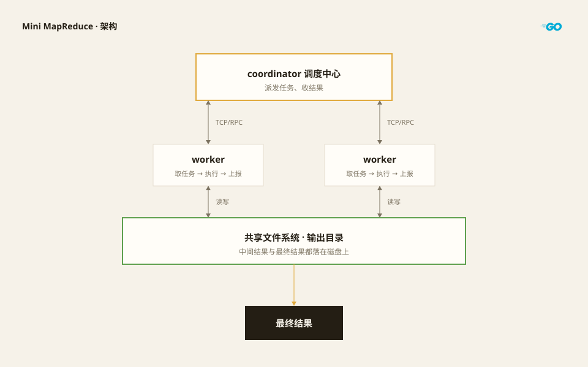

用Go实现最简分布式计算 mapreduce

--------

## 架构图



### 通信协议

`rpc`

-----

### 角色

本项目中有两个角色`coordinator`和`worker`

`coordinator`在启动时传入任务, 随后接收`worker`调用`RequestTask`方法, 供`worker`获取任务

- `coordinator`: 负责任务调度(分配、超时重派、收尾), 保存任务状态(c.maps / c.reduces), 并通过 RPC 对外暴露 `RequestTask` / `ReportTask` / `Done`
- `worker`: 主动向 coordinator 轮询拉取任务(RequestTask), 执行 map/reduce, 再上报结果(ReportTask), 循环往复直到收到 `ExitTask`

两者共享文件系统, 中间产物通过磁盘文件交换, 不通过网络传输数据

----------

## 实现细节

--------

### 优雅退出

```go
	ctx, stop := signal.NotifyContext(context.Background(), os.Interrupt)
	defer stop()
```

注册一个能响应Ctrl+C信号的上下文, 当Ctrl+C信号被发送时, 上下文会被取消, `stop()` 释放资源,从而触发程序的优雅退出

-------

### 调度与任务状态

worker 每次调用 `RequestTask`, coordinator 根据当前进度返回四种结果之一:

| 返回 `task.Type` | 含义 | worker 行为 |
| ---------------- | ---- | ----------- |
| `map`            | 派发一个 map 任务 | 读对应输入文件, 执行 map, 按分区写中间文件 |
| `reduce`         | 派发一个 reduce 任务 | 读所有 map 对应分区的中间文件, 聚合后写结果 |
| `wait`           | 暂无任务可分配 | 等待100ms后再来 |
| `exit`           | 所有任务完成 | worker 正常退出 |

coordinator 按"先 map 后 reduce"的顺序调度: `c.maps` 全部 `done` 后才开始派 `c.reduces`。

任务状态 `taskState{attempt, started, done}`:

- `attempt++` 标记每次执行轮次, 区分不同尝试产生的文件
- `started` 记录派发时间; 若超过 `timeout`(默认10s) 仍未完成, 视为 worker 卡死, coordinator 会重新分配该任务 → 故障容错
- 加锁 `c.mu` 保护状态, 支持多 worker 并发调度

------

### worker 执行流程

```
for {
    task := RequestTask()          // 拉任务
    switch task.Type {
        case exit: return          // 完成, 退出
        case wait: sleep 100ms; continue
        case map:  runMap
        case reduce: runReduce
    }
    if err != nil { removeOutputs(task) }   // 失败则清理本次尝试的输出
    ReportTask(report)              // 上报 成功/失败
}
```

### 文件落盘

coordinator 启动时用 `-out` 指定输出目录, 并创建该目录(`NewCoordinator` 用 `os.Mkdir` 创建, 已存在则拒绝, 防止覆盖)。

命名规则(`rpc.go`):

- map 中间结果: `mr-map-<mapID>-<attempt>-<分区号>.json`
- reduce 结果(临时): `mr-reduce-<reduceID>-<attempt>.tmp`
- 最终结果: `mr-out-<reduceID>` (由 coordinator 在 `ReportTask` 验证后 rename 发布)

写文件统一走 `writeOutput`: 先建临时文件 `.mr-*` → 写入并 flush/close → `os.Rename` 原子重命名为目标名。这样写失败不留残缺文件, 成功则结果原子可见。

### 数据流

```
输入文件 --map--> (key,value) --partition分桶--> 各分区 .json 中间文件
                    ↓
       reduce 任务读取相同分区的中间文件, 按键聚合
                    ↓
       mr-reduce-<id>-<attempt>.tmp --coordinator rename--> mr-out-<id>
```

`partition` 用 FNV-1a 哈希 + 去符号 + 取模, 把相同 key 稳定映射到同一分区, 保证"相同 key 汇总到同一 reduce"。

### 采用的设计思想

- 优雅停机: 信号 → context → 清理链, Ctrl+C 干净退出
- 命令分发: main 按子命令分发到 coordinator / worker
- 分层封装: main(入口) → run(编排) → Coordinator/Worker(实现)
- Fail-Fast: 出错 return error, main 用 `errors.Is` 区分"取消"与"真错误"
- RPC 反射: coordinator 用 `RegisterName("Coordinator", c)` 暴露方法, worker 用 "服务名.方法名" 精确匹配调用

## 参考文献

- https://pdos.csail.mit.edu/6.824/papers/mapreduce.pdf

## 项目源码

- [MapReduce 项目源码](https://github.com/222twotwotwo/222twotwotwo/tree/main/6.824/mapreduce)
