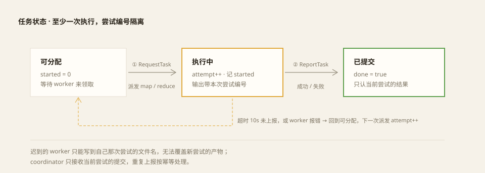

用 Go 实现最简的分布式计算 MapReduce

## **架构**


整个系统只有两个角色，`worker` 可以起任意多个：

- **coordinator**：负责任务调度（分配、超时重派、收尾），保存任务状态（`c.maps` / `c.reduces`），并通过 RPC 对外暴露 `RequestTask` / `ReportTask` / `Done`。
- **worker**：主动向 coordinator 轮询拉取任务（`RequestTask`），执行 map/reduce，再上报结果（`ReportTask`），循环往复直到收到 `ExitTask`。

两者共享文件系统，中间产物通过磁盘文件交换，不通过网络传输数据。这点和 GFS 里"控制流与数据流分离"是同一个思路：coordinator 只管派活和验收，不搬运数据，所以它不会成为带宽瓶颈。

### 通信协议

`rpc`

coordinator 用 `RegisterName("Coordinator", c)` 把方法暴露出去，worker 用 `Coordinator.RequestTask` 这种"服务名.方法名"精确匹配调用。

## 实现细节

### 优雅退出

```go
ctx, stop := signal.NotifyContext(context.Background(), os.Interrupt)
defer stop()
```

注册一个能响应 Ctrl+C 信号的上下文。信号到达时上下文被取消，`stop()` 释放资源，监听循环随后退出，程序走得干净。

### 调度与任务状态

worker 每次调用 `RequestTask`，coordinator 根据当前进度返回四种结果之一：

| 返回 `task.Type` | 含义 | worker 行为 |
| --- | --- | --- |
| `map` | 派发一个 map 任务 | 读对应输入文件，执行 map，按分区写中间文件 |
| `reduce` | 派发一个 reduce 任务 | 读所有 map 对应分区的中间文件，聚合后写结果 |
| `wait` | 暂无任务可分配 | 等待 100ms 后再来 |
| `exit` | 所有任务完成 | worker 正常退出 |

coordinator 按"先 map 后 reduce"的顺序调度：`c.maps` 全部 `done` 之后才开始派 `c.reduces`。

任务状态是 `taskState{attempt, started, done}`：

- `attempt++` 标记每次执行轮次，用来区分不同尝试产生的文件。
- `started` 记录派发时间；超过 `timeout`（默认 10s）仍未完成，视为 worker 卡死，coordinator 重新分配该任务，这就是故障容错。
- 加锁 `c.mu` 保护状态，支持多 worker 并发调度。



### worker 执行流程

```
for {
    task := RequestTask()          // 拉任务
    switch task.Type {
        case exit: return          // 完成, 退出
        case wait: sleep 100ms; continue
        case map:  runMap
        case reduce: runReduce
    }
    if err != nil { removeOutputs(task) }   // 失败则清理本次尝试的输出
    ReportTask(report)              // 上报 成功/失败
}
```

### 文件落盘

coordinator 启动时用 `-out` 指定输出目录，并创建该目录（`NewCoordinator` 用 `os.Mkdir` 创建，已存在则拒绝，防止覆盖上一次的结果）。

命名规则（`rpc.go`）：

- map 中间结果：`mr-map-<mapID>-<attempt>-<分区号>.json`
- reduce 结果（临时）：`mr-reduce-<reduceID>-<attempt>.tmp`
- 最终结果：`mr-out-<reduceID>`（由 coordinator 在 `ReportTask` 验证后 rename 发布）

写文件统一走 `writeOutput`：先建临时文件 `.mr-*`，写入并 flush/close，再用 `os.Rename` 原子重命名为目标名。这样写失败不会留下残缺文件，成功则结果原子可见。

### 数据流

```
输入文件 --map--> (key,value) --partition分桶--> 各分区 .json 中间文件
                    ↓
       reduce 任务读取相同分区的中间文件, 按键聚合
                    ↓
       mr-reduce-<id>-<attempt>.tmp --coordinator rename--> mr-out-<id>
```

`partition` 用 FNV-1a 哈希 + 去符号 + 取模，把相同 key 稳定映射到同一分区，保证"相同 key 汇总到同一个 reduce"。

### 采用的设计思想

- **优雅停机**：信号 → context → 清理链，Ctrl+C 干净退出。
- **命令分发**：main 按子命令分发到 coordinator / worker。
- **分层封装**：main（入口）→ run（编排）→ Coordinator / Worker（实现）。
- **Fail-Fast**：出错 `return error`，main 用 `errors.Is` 区分"取消"与"真错误"。
- **RPC 反射**：coordinator 用 `RegisterName("Coordinator", c)` 暴露方法，worker 用"服务名.方法名"精确匹配调用。

## 参考文献

- Jeffrey Dean, Sanjay Ghemawat. [MapReduce: Simplified Data Processing on Large Clusters](https://pdos.csail.mit.edu/6.824/papers/mapreduce.pdf). OSDI 2004.

## 项目源码

- [MapReduce 项目源码](https://github.com/222twotwotwo/222twotwotwo/tree/main/6.824/mapreduce)
