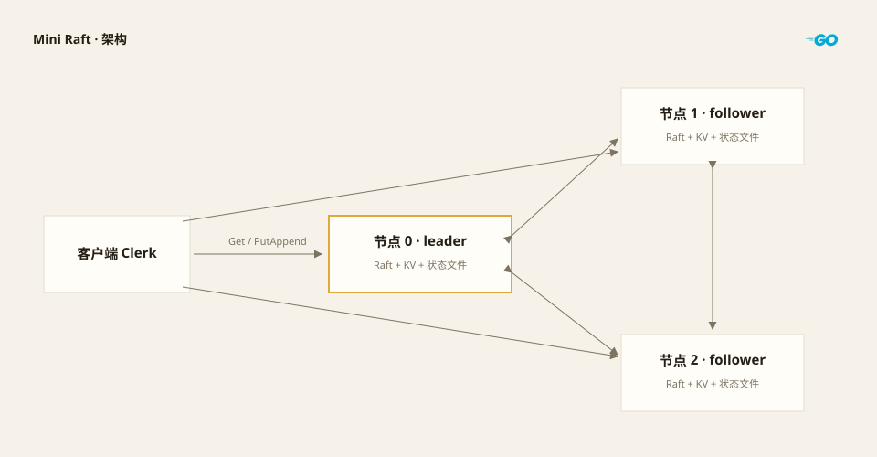

用Go实现的最简raft分布式共识算法

-------

## 架构图



图中的角色（leader / follower）只是某个任期下的瞬时快照：leader 由选举产生，任期变了就可能换人，节点本身地位对等。每个节点内部是 Raft 加 KV 状态机，加上一份状态文件。客户端不区分 leader，三条连线都会试，连到 follower 上写请求会被拒绝，换节点重试即可

## 应用

本项目raft服务于一个KV状态机


----------

## raft节点设计

```go
type Raft struct {
	//...
	applyCh   chan ApplyMsg

	mu   sync.Mutex
	rand *rand.Rand

	state       State
	currentTerm int
	votedFor    int
	log         []LogEntry // log[0] 是快照边界，index 为 snapshotIndex

	//...
}
```


-----
## 键值存储系统

raft地位类似中间件，当leader收到消息一个请求在过半节点已经写入Log时，leader广播commit,此时follower的raft会允许请求在kv状态机中执行

因此，kv状态机除基本的对内对外的键值增删改查外，还需要通过`ApplyCh`通道接收raft的控制指令
为了让kv状态机可以从某个log开始恢复，`ApplyCh`还可以承担发送快照指令的任务

-----------
## 选举

每个raft节点只能投一票，在半数以上节点同意时可成为leader
```go
func (rf *Raft) becomeLeader(){}
```
为了避免出现许多节点同时发起选举导致卡死的情况，raft节点会随机等待一段时间，再发起选举
```go
func (rf *Raft) resetElectionDeadline() {
	timeout := rf.cfg.ElectionMin
	if gap := rf.cfg.ElectionMax - rf.cfg.ElectionMin; gap > 0 {
		timeout += time.Duration(rf.rand.Int63n(int64(gap)))
	}
	rf.electionDeadline = time.Now().Add(timeout)
}
```
候选人是所有节点中日志最新的那个节点
```go
upToDate := args.LastLogTerm > lastTerm ||
	(args.LastLogTerm == lastTerm && args.LastLogIndex >= lastIndex)

if upToDate && (rf.votedFor == -1 || rf.votedFor == args.CandidateID) {
	rf.votedFor = args.CandidateID
	rf.resetElectionDeadline()
	rf.persist()
	reply.VoteGranted = true
}
```

---------------
## 日志

每条日志只有任期和命令两部分，命令是 `[]byte`，raft 不解析内容，键值服务自己把 `Op` 编码成 JSON 塞进去

```go
type LogEntry struct {
	Term    int
	Command []byte
}
```


```go
func (rf *Raft) lastLogIndex() int {
	return rf.snapshotIndex + len(rf.log) - 1
}

func (rf *Raft) logTerm(index int) int {
	if index < rf.snapshotIndex || index > rf.lastLogIndex() {
		return -1
	}
	return rf.log[index-rf.snapshotIndex].Term
}
```

`lastLogIndex` 是本地最后一条，`commitIndex` 是多数派确认过的位置，`lastApplied` 是已经交给状态机的位置，始终 `lastApplied <= commitIndex <= lastLogIndex`

-----------
### 追加与复制

leader 收到命令先追加再叫醒复制协程，不是每条命令起一个 goroutine

```go
rf.log = append(rf.log, LogEntry{Term: rf.currentTerm, Command: command})
rf.persist()
rf.signalReplication()
```

每个 follower 一个长期运行的复制协程，维护两个数：`nextIndex` 是下次发的起始下标，`matchIndex` 是已确认它有了的最高下标，有新日志就立刻发，没有就按心跳间隔发空 `AppendEntries`


---------------
### 冲突回退

follower 先校验 `PrevLogIndex` / `PrevLogTerm`，对不上就返回冲突任期和该任期第一次出现的下标

```go
if rf.logTerm(args.PrevLogIndex) != args.PrevLogTerm {
	term := rf.logTerm(args.PrevLogIndex)
	reply.ConflictTerm = term
	idx := args.PrevLogIndex
	for idx > rf.snapshotIndex+1 && rf.logTerm(idx-1) == term {
		idx--
	}
	reply.ConflictIndex = idx
	return nil
}
```

leader 拿这个任期在自己日志里找最后一条，`nextIndex` 一次退到它后面，自己也没有这个任期，就直接用 `ConflictIndex`，逐条回退差几百条就要几百个 RPC，这样一次就够

截断前还要判断 `idx <= commitIndex`，已提交的日志不能被覆盖，真出现说明算法已经错了，可拒绝这次追加

---------------
## 快照

快照存的是状态机数据加边界下标，日志在生成快照时被裁掉，不是把 Log 也存一份

为什么需要？
日志会无限增长，节点重启要重放全部日志；落后的 follower 需要的日志也可能已经被 leader 裁掉，这时只能从 leader 获取一份快照

快照模块需要实现以下功能

本机故障恢复时，需要从快照中恢复状态
```go
func (rf *Raft) ReadSnapshot() (int, []byte) {}
```
生成快照释放Log
```go
func (rf *Raft) Snapshot(index int, data []byte) bool {}
```
follower需要从leader获取并使用快照
```go
func (rf *Raft) InstallSnapshot(args *InstallSnapshotArgs, reply *InstallSnapshotReply) {}
```

## 项目源码

- [Raft 项目源码](https://github.com/222twotwotwo/222twotwotwo/tree/main/6.824/raft)
